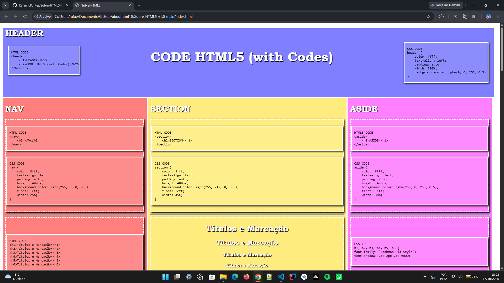
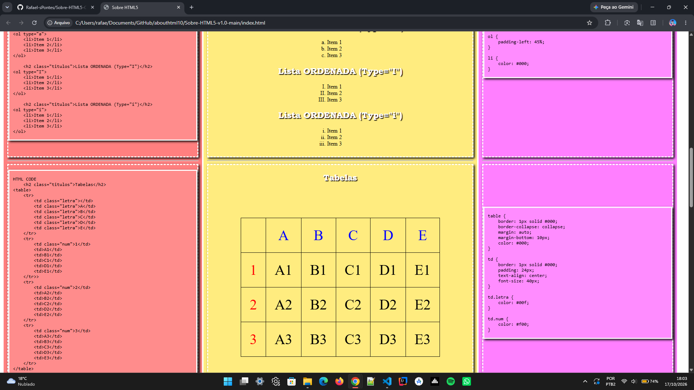

# Sobre HTML5 / CSS3 v2.0

# 📚 Guia Interativo de Conceitos HTML5 & CSS3 (with Codes)

Este projeto tem como objetivo demonstrar e consolidar os principais conceitos e elementos do **HTML5** e **CSS3** de forma prática e visual. A ideia principal da página é exibir o elemento renderizado na tela simultaneamente ao seu código-fonte correspondente (HTML e CSS), funcionando como um guia de referência rápida e interativo.

---

## 🚀 Versões do Projeto

### 📌 v1.0 (Versão Inicial)
A primeira versão cumpriu o objetivo principal de estruturar os painéis de layout (`header`, `nav`, `section`, `aside`, `footer`) e listar as tags básicas de marcação, imagens, tabelas, áudio e vídeo.
* **Limitações iniciais:** 
  * Organização de estilos dispersa e seletores menos padronizados.
  * Uso excessivo de posicionamentos manuais complexos (`transforms` e `floats`) para alinhar os blocos de código (`<pre>`).
  * Manutenibilidade mais difícil do layout em telas diferentes.

  
  

### ✨ v2.0 (Versão Atual / Refatorada)
Nesta nova versão, o projeto passou por uma reestruturação profunda do layout, código limpo e padronização do CSS para melhorar drasticamente a experiência visual e a semântica.
* **Principais Melhorias e Evoluções:**
  * **Correção e Padronização de Layout:** Ajustes finos no alinhamento dos elementos e estruturação geométrica dos painéis de conteúdo.
  * **Organização do Código CSS:** Modularização dos seletores, padronização de tipografia (`Bookman Old Style` e `Courier New`) e uso mais eficiente de caixas de sombra (`box-shadow`) e bordas tracejadas.
  * **Otimização dos Blocos de Código (`<pre>` / `<code>`):** Reorganização das caixas de código para que acompanhem a estrutura visual dos blocos de navegação sem quebrar o design responsivo.
  * **Correção de Semântica e Sintaxe:** Padronização correta de atributos de listas ordenadas/não ordenadas, tabelas e mídias locais e via *iframe*.

  
  

---

## 🛠️ Tecnologias Utilizadas

* **HTML5:** Estruturação semântica da página (`header`, `nav`, `section`, `aside`, `footer`, `figure`, `details`, etc.).
* **CSS3:** Estilização avançada, Flexbox, seletores personalizados, sombras e layout em painéis.
* **Git & GitHub:** Controle de versão e hospedagem via GitHub Pages.
